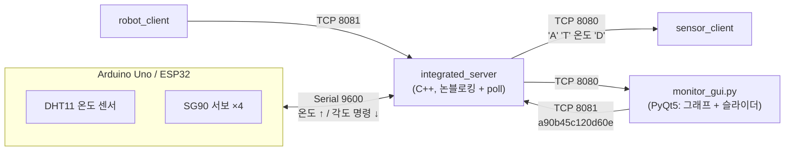

# Arduino 센서 모니터링 & 4축 로봇암 원격 제어 (TCP/IP + Serial)


Linux PC가 아두이노(또는 ESP32)와 **시리얼**로 통신하고, 같은 데이터를 **TCP/IP**로 여러 클라이언트에 중계하는 프로젝트입니다.
DHT11 온도 센서 값은 실시간으로 모니터링하고, SG90 서보 4개로 만든 로봇암은 원격으로 제어합니다.
외부 라이브러리 없이 **POSIX 소켓**(`sys/socket.h`, `poll`)과 **termios**만으로 C++ 서버를 작성했습니다.



## 구성

| 폴더 | 내용 | 포트 |
|---|---|---|
| `sensor/` | 온도 센서 서버(**논블로킹**, 다중 클라이언트)와 클라이언트 | 8080 |
| `robot/` | 로봇암 서버(**블로킹** 소켓 + `poll`)와 터미널 조종 클라이언트 | 8081 |
| `integrated/` | 통합 서버: 보드 하나로 센서와 로봇암을 동시에 처리 | 8080 + 8081 |
| `gui/` | PyQt5 GUI: 온도 그래프와 로봇암 슬라이더 | (클라이언트) |
| `arduino/` | 보드 스케치 3종 (Arduino Uno / ESP32 공용) | |

## 설계 포인트

- **시리얼 포트 하나를 두 TCP 서비스가 공유**
  - 보드에는 시리얼 포트가 하나뿐이라 센서 서버와 로봇 서버를 동시에 띄울 수 없습니다.
  - 그래서 `integrated_server`가 포트를 혼자 열고, 8080과 8081 두 TCP 포트를 함께 엽니다.
  - 기존 클라이언트와 GUI는 수정 없이 그대로 접속합니다.
- **단일 스레드 이벤트 루프**: 리스닝 소켓, 클라이언트 소켓, 시리얼 fd를 모두 `poll()`로 감시합니다. 읽을 데이터가 있는 곳만 처리하고, 연결을 받을 때는 `accept`를 `EAGAIN`이 나올 때까지 반복합니다.
- **견고성**
  - 끊긴 클라이언트에 `send`해도 `SIGPIPE`로 서버가 죽지 않도록 `MSG_NOSIGNAL`을 씁니다.
  - 서버를 재시작하면 바로 같은 포트를 다시 쓸 수 있도록 `SO_REUSEADDR`를 켭니다.
  - 로봇 명령은 형식, 각도 범위(0–180), 줄 길이(최대 64자)를 검사한 뒤에만 보드로 보냅니다.
  - 센서 값이 정상 범위(−40–125 ℃)를 벗어나면 노이즈로 보고 버립니다.
  - 시리얼 포트를 열면 보드가 리셋되므로 부팅 메시지를 최대 3초 기다립니다.
- **하드웨어 없이 개발**
  - 인자 없이 실행하면 `/dev/ttyUSB0`, `/dev/ttyACM0` 순서로 보드를 찾고, 없으면 가상(dummy) 모드로 자동 전환합니다.
  - `dummy` 인자를 주면 보드가 연결돼 있어도 가상 모드로 실행합니다.
- **보드 하나의 스케치로 Uno와 ESP32 지원**: `#if defined(ARDUINO_ARCH_AVR / ESP32)`로 라이브러리(`Servo` / `ESP32Servo`)와 핀 배치를 자동으로 고릅니다. ESP32에서는 부팅 스트래핑 핀과 입력 전용 핀을 피했습니다.
- **GUI**
  - 연결이 끊기면 2초마다 자동으로 다시 접속합니다.
  - 슬라이더를 드래그하는 동안 명령을 최대 50 ms 간격으로만 보냅니다.
  - 3초 동안 데이터가 오지 않으면 "데이터 없음"으로 표시합니다.

## 프로토콜

| 구간 | 형식 | 예 |
|---|---|---|
| 서버 → 센서 클라이언트 (TCP 8080) | 4바이트 `'A' 'T' <온도 정수> 'D'`, 100 ms 주기 | `41 54 17 44` (23 ℃) |
| 로봇 클라이언트 → 서버 (TCP 8081) | `a<base>b<shoulder>c<upperarm>d<forearm>e\n` (각 0–180) | `a90b45c120d60e` |
| 서버 → 보드 (시리얼 9600) | 위 로봇 명령과 같은 형식 | `a90b45c120d60e` |
| 보드 → 서버 (시리얼 9600) | 온도: 숫자만 있는 한 줄 / 상태: `#`으로 시작하는 한 줄 | `23.0`, `# reached ...` |

## 빌드

**환경**: Ubuntu 24.04 · g++ (C++14) · CMake 3.10+ · Python 3 (PyQt5, matplotlib)

```bash
git clone https://github.com/pth6254/arduino-sensor-robot-tcp.git
cd arduino-sensor-robot-tcp

cmake -S . -B build
cmake --build build                    # build/ 아래에 실행 파일 5개 생성

pip install -r requirements.txt        # GUI 용 (또는 sudo apt install python3-pyqt5 python3-matplotlib)
```

## 실행

모든 서버는 보드가 없어도 가상 모드로 실행됩니다.

### GUI로 온도 모니터링과 로봇암 제어를 함께 (통합 서버)

```bash
./build/integrated_server        # 터미널 1 (보드 없이: ./build/integrated_server dummy)
python3 gui/monitor_gui.py       # 터미널 2 (다른 PC에서 접속: --host <서버IP>)
```

### 센서만

```bash
./build/sensor_server            # 터미널 1
./build/sensor_client            # 터미널 2 (여러 개 동시 접속 가능)
```

### 로봇암만

```bash
./build/robot_server             # 터미널 1
./build/robot_client             # 터미널 2
> base 120                       # 한 축만 변경
> 90 60 120 45                   # Base Shoulder Upperarm Forearm
> show / q
```

GUI와 터미널 클라이언트는 섞어 써도 됩니다(예: `integrated_server` + `sensor_client` + GUI).

## 보드 설정

보드에는 스케치를 하나만 올릴 수 있으므로 쓰려는 서버에 맞는 스케치를 올립니다.

| 스케치 | 짝이 되는 서버 |
|---|---|
| `arduino/sensor_dht11` | `sensor_server` |
| `arduino/robot_arm` | `robot_server` |
| `arduino/integrated` | `integrated_server` (GUI로 둘 다 쓸 때) |

```bash
# Uno (ESP32는 --fqbn esp32:esp32:esp32)
arduino-cli compile --upload -p /dev/ttyUSB0 --fqbn arduino:avr:uno arduino/integrated
```

- 필요 라이브러리: `DHT sensor library`, `Adafruit Unified Sensor`, (ESP32) `ESP32Servo`
- 업로드할 때는 서버를 꺼 둡니다. 서버가 시리얼 포트를 잡고 있으면 업로드가 실패합니다.
- 업로드 직후와 서버를 시작할 때 보드가 리셋되면서 **서보 4개가 90°로 움직입니다.**

### 배선

| 부품 | Arduino Uno | ESP32 DevKit |
|---|---|---|
| DHT11 DATA / VCC | D2 / 5V | GPIO4 / 3V3 |
| 서보 Base / Shoulder / Upperarm / Forearm | D3 / D5 / D6 / D9 | GPIO13 / 14 / 27 / 26 |

서보 전원은 외부 5V를 권장합니다(SG90 4개 기준 5V 2A 이상). GND는 보드와 공통으로 연결합니다.

## 라이선스

[MIT License](LICENSE)
